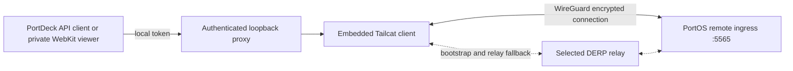

# Private fleet connectivity with Tailcat

PortDeck has an experimental, optional Tailcat transport for reaching user-owned
PortOS instances without a Tailscale account or hosted coordination server. It
embeds the upstream Go library, including WireGuard and NAT traversal. Each fleet
profile chooses its own connection: existing HTTP/HTTPS profiles continue using
their existing network; Tailcat profiles use the private transport below.

The transport can forward WebSockets, but the Tailcat viewer remains disabled
unless `/api/remote-desktop/status` explicitly reports
`tailcatIngressSupported: true`. The server work is tracked in
[PortOS #13634](https://github.com/atomantic/PortOS/issues/13634).
Existing servers serve REST/HTML on 5565 without
mounting the remote-desktop WebSocket broker there. The companion capability is
additive and absent means unsupported; direct viewers retain their existing behavior.

This is app-scoped connectivity. It does not install an iOS VPN profile, change
system routes, provide an exit node, or connect unrelated applications. The Go
runtime follows the app's lifecycle; tunnels close in the background and reopen
lazily when a foreground request needs them. A Tailcat remote-desktop viewer closes
on backgrounding and can be opened again for a new session.

## Pair an instance

1. On a trusted PortOS instance, enable its instance password and managed
   **Instances → Tailcat serve**. Copy the full address privately. The managed
   listener must expose the isolated remote ingress on **5565**.
2. In PortDeck, choose **Fleet → Add an instance → Connect privately with Tailcat**.
3. Paste the full address and supply that instance's password. Addresses must
   include a WireGuard pre-shared key, separate discovery key, and embedded relay
   information. Short addresses requiring a default DERP-map lookup are rejected.
4. If the PortOS ingress uses HTTPS, enable that option and enter the DNS name on
   its trusted certificate. Certificate checks remain enabled. The tunnel always
   targets remote port 5565; it never silently falls back to the main API on 5555.
5. **Verify private connection** checks real health and authenticated topology
   through the tunnel. Inspect the reported instance and pinned public key, then
   **Add to fleet**. Binding the local proxy alone never marks an instance online.

The prototype rejects password-free instances. Its first pairing method is manual
out-of-band exchange; it does not automatically trust discovered peers. A node
already in Fleet must have its old profile removed before adding its Tailcat
profile. Changing a pinned server identity also requires explicit re-pairing.

In **Settings → Tailcat prototype**, display/copy this phone's public client key
for a server's Tailcat allowlist. The stable private device key never appears in
the UI. Do not publish the full server address: it contains a secret PSK.

## Data and trust boundaries



- The full server address pins its WireGuard identity and PSK. There is no
  Tailscale coordination-server enrollment or automatic identity replacement.
- Pairings, instance passwords for Tailcat profiles, and the phone's private key
  use non-synchronizable, `WhenUnlockedThisDeviceOnly` Keychain items. Tailcat
  profiles are excluded from fleet iCloud sync, including password migration.
- SwiftData holds only a reserved routing identifier and ordinary instance
  metadata. The routing identifier contains no capability and is never resolved
  through DNS. Missing pairings fail closed instead of using the direct network.
- The local proxy listens only on a random IPv4 loopback port and requires a
  random 256-bit admission token. It forwards to one fixed remote ingress. It
  rejects unexpected Host/Origin values, proxy requests, and CONNECT, removes its
  own credential before forwarding, and refuses cross-origin redirects.
- API requests disable localhost cookie handling because cookies are not
  port-scoped. Each remote-desktop viewer instead uses its own non-persistent
  WebKit store and an HttpOnly local admission cookie for resources/WebSockets.
- HTTPS verification occurs inside the encrypted connection, against the provided
  certificate host name. No self-signed certificate exception is installed.
- Closing a tunnel closes HTTP and upgraded WebSocket connections. Forgetting a
  profile removes its saved pairing; the phone's identity remains stable for its
  other approved instances.
- Native errors use bounded, fixed messages. Upstream diagnostic logging is
  disabled so capabilities/private keys do not enter app logs.

The copied address selects the relay. Existing PortOS-managed addresses may name
Tailscale-operated relays. To avoid that dependency, configure a self-hosted DERP
relay on PortOS and privately copy its full address; this client uses the embedded
relay configuration without fetching the hosted default map. Relays can observe
connection metadata and affect availability. They should not possess the server
capability, phone key, or authority to approve a device.

## Server work and prototype limits

PortOS already manages capability-based Tailcat serve/forward processes and marks
5565 ingress traffic as remote. That remote-authority boundary remains essential:
a loopback hop must not acquire local host-control privileges.

The inspected managed listener does **not** yet maintain a per-device allowlist or
offer device revocation. Those capabilities are tracked in
[PortOS #13624](https://github.com/atomantic/PortOS/issues/13624). Until that lands,
the prototype relies on the privately exchanged capability plus the instance
password. Showing/copying a phone public key does not itself enroll or approve it.
Removing a profile does not revoke a stolen copy of its secrets remotely; manage
access on the server. Owner-approved device keys and active-session revocation
must be validated before describing this as a complete security replacement.

Tailcat is experimental and its API/wire format can change. The bridge pins
**v0.7.0** and the mobile toolchain in `Native/TailcatBridge/go.mod`/`go.sum`.
Device compromise, a compromised PortOS endpoint, and compromised dependency
updates are separate risks from hosted coordination-server compromise.

## Build and validate

Install Xcode and Go **1.27.3 or newer**. The generated XCFramework is intentionally
untracked; both device and simulator slices are built from pinned source:

```bash
./scripts/build_tailcat_bridge.sh
xcodegen generate
```

The script caches the framework against bridge sources, lockfiles, build flags,
Go, and Xcode. CI builds it before generating the project. Local deployment and
screenshot scripts use the same build step. `project.yml` remains authoritative.
The operator approved Apple’s questionnaire answers for the bundled standard
encryption: standard algorithms outside Apple’s OS, no proprietary/nonstandard
algorithms, and no France distribution. Apple reports that this path requires no
document upload. `ITSAppUsesNonExemptEncryption = NO` records exemption from
Apple’s documentation requirement; it does not claim the app lacks encryption
or settle separate export-law or annual reporting obligations. Reassess these
answers before changing cryptography or enabling France distribution.

```bash
cd Native/TailcatBridge
go test -race ./...
# Opt-in network test: ephemeral identities and synthetic data only.
PORTDECK_TAILCAT_INTEGRATION=1 go test -run '^TestWireGuardRoundTrip$' -count=1 -timeout=60s
```

The normal native tests validate admission, redirect confinement, HTTPS trust,
WebSocket forwarding/shutdown, and rejection of unsafe addresses. Swift tests
exercise the linked bridge, device-only Keychain queries, credential routing,
pairing lifecycle, missing-pairing refusal, and fleet-sync isolation. Signed
simulator tests additionally exercise real Keychain storage. The UI test opens
the actual form and rejects an invalid capability without network access.

The opt-in WireGuard test uses an ephemeral server and approved client through
relay bootstrap. It proves an encrypted HTTP round trip, not roaming between
different physical networks. Before wider use, verify a real iPhone over cellular
against a separate PortOS host, Wi-Fi/cellular transitions, a blocked-UDP relay
path, HTTPS, and remote desktop. No production fleet credentials are needed by
the automated tests.

Upstream: [Tailcat source and license](https://github.com/tailscale/tailcat/tree/v0.7.0),
[security model](https://github.com/tailscale/tailcat/blob/v0.7.0/SECURITY.md).
